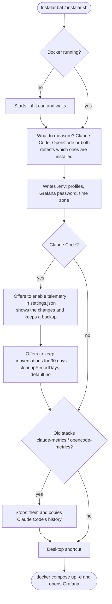
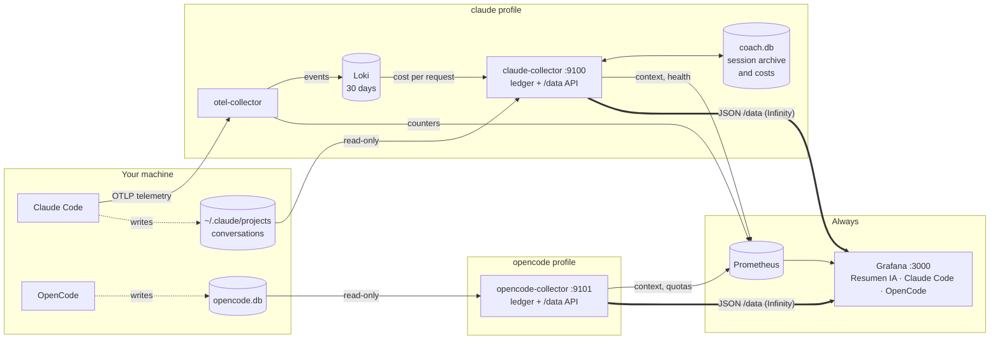
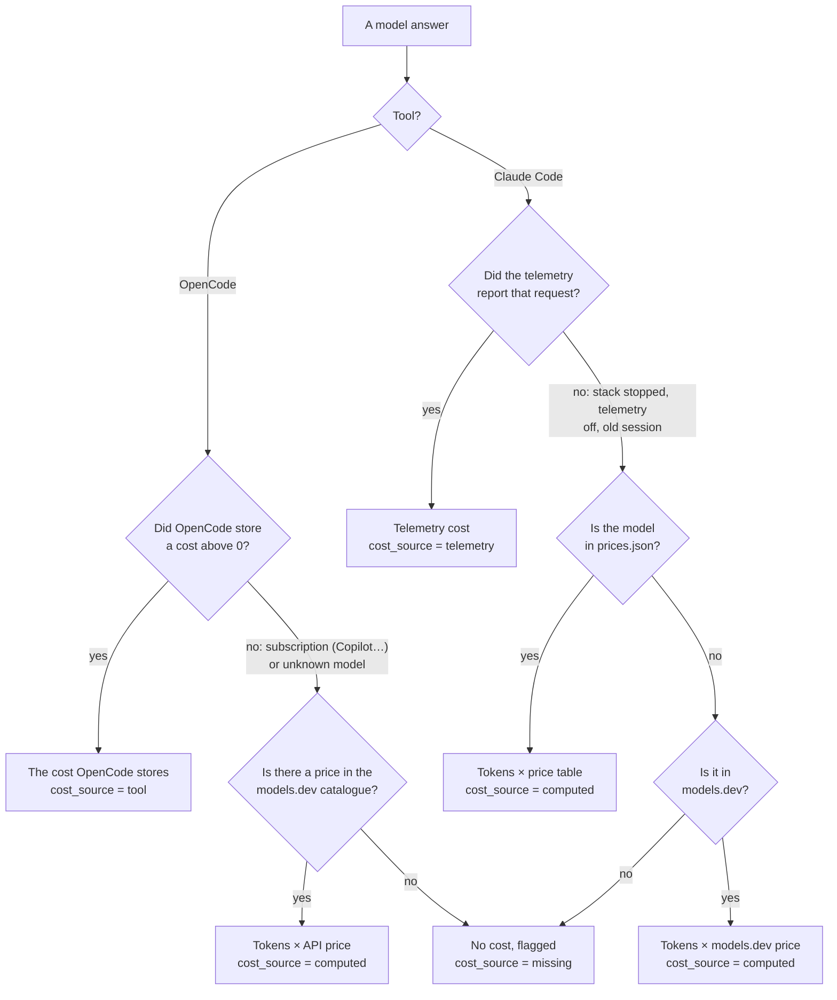
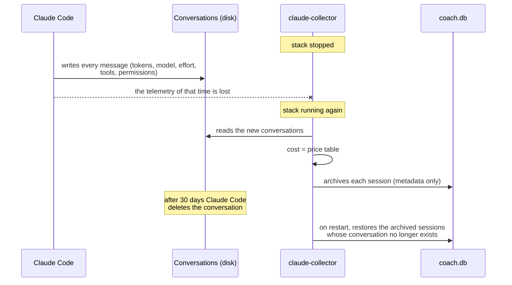

# IA-metrics

[Español](README.md) · **English**

Local observability stack for coding assistants: **how much you use and how much it costs** Claude Code,
OpenCode or both. It merges the `claude-metrics` and `opencode-metrics` projects into a single repository,
with a shared Prometheus and Grafana and a dashboard that adds up the spend of both tools.

- **Cost, tokens, sessions, models, agents, effort, skills, commands and tools**, per project, with
  Grafana's time picker, in your local time.
- **Full history**, including what you did while the stack was stopped: the collectors read Claude Code's
  conversations and OpenCode's database, not only the telemetry.
- **Improvement report** with findings and recommendations, downloadable as Markdown to give to an AI.
- **Local and private**: everything on `127.0.0.1`, nothing leaves your machine.

## Installation

Requirement: Docker (Docker Desktop, Rancher Desktop or Podman with `docker compose`). It runs on Windows,
macOS and Linux. Python 3 is optional: if present the installer uses it; if not, it runs in a container. The first start needs internet access to download the images and Grafana's
Infinity plugin.

Run the installer; to change the tools later, run it again:

- **Windows:** double-click **`Instalar.bat`**.
- **macOS / Linux:** `./instalar.sh` (or `python3 installer/install.py`).

The installer is a single `installer/install.py` for all three systems; the `.bat` and `.sh` files launch it through
`installer/run.bat` and `installer/run.sh`. Without Python on the computer they run it in a container
(`python:3.13-alpine`, the same image as the collectors) and do the Docker steps themselves: starting the stack, the
shortcut, updating and removing the containers. Without Python the old stacks are not migrated.



Unattended: `Instalar.bat --tools claude,opencode` / `./instalar.sh --tools claude,opencode`
(other options: `--no-start`, `--skip-claude-settings`, `--skip-migration`, `--no-shortcut`).

**Update:** `Actualizar.bat` / `./actualizar.sh` (or `install.py --update`) pulls the new code with `git pull`
if the repository has no local changes, pulls the images and restarts the stack (also the services that did not change, so the collectors load
the new code and Grafana, Prometheus and the collector their configuration); history is kept.

**Uninstall:** `Desinstalar.bat` / `./desinstalar.sh` (or `install.py --uninstall`) removes the containers,
removes from `settings.json` the telemetry variables the installer added (after a backup) and the shortcut,
and asks whether to delete the history too (`--remove-data` deletes it without asking; `--force` asks
nothing). The project folder and `.env` stay.

**Start later:** `Iniciar-metricas.bat` / `./iniciar-metricas.sh` (or `install.py --start`).

By hand: copy `.env.example` to `.env`, set `GRAFANA_ADMIN_PASSWORD` and `COMPOSE_PROFILES`
(`claude`, `opencode` or `claude,opencode`) and run `docker compose up -d`.

The installer, the dashboards and the improvement report are in Spanish.

## What opens

| Address | What it is |
| --- | --- |
| http://localhost:3000 | Grafana (user `admin`). Home: **Resumen IA**, the spend of both tools and the source status (whether the data is up to date) |
| http://localhost:3000/d/claude-code | Claude Code dashboard — [guide (es)](docs/claude-code.md) |
| http://localhost:3000/d/opencode-usage | OpenCode dashboard — [guide (es)](docs/opencode.md) |
| http://localhost:9100/sessions · `/report` · `/prices` | Claude Code sessions, improvement report and model prices |
| http://localhost:9101/sessions · `/report` · `/prices` | OpenCode sessions, improvement report and model prices |

What each chart shows and how to read it: [chart guide](docs/dashboards.en.md).

Prometheus, Loki and the OTel Collector are not published on your machine (they have no authentication):
Grafana and the collectors reach them over Docker's internal network. Only 4317 stays open, where Claude
Code sends its telemetry. To debug: `docker compose -f docker-compose.yml -f docker-compose.debug.yml up -d`
opens 9090, 3100, 4318 and 8889 (always on `127.0.0.1`); `docker compose up -d` closes them again.

## Architecture



- **Docker Compose profiles.** Prometheus and Grafana always start; the rest depends on
  `COMPOSE_PROFILES` in `.env` ([ADR 0001](docs/adr/0001-pila-unica-docker-compose-con-perfiles.md)).
- **Per-request ledger and data API.** Each collector keeps one row per model answer, with the same
  columns for both tools, and serves it as JSON (`/data`). Grafana reads it with the Infinity datasource
  and the time picker; Prometheus is left for current state (session context, quotas, health)
  ([ADR 0002](docs/adr/0002-registro-por-peticion-y-api-de-datos.md)).
- **One codebase, two collectors.** Standard-library Python on `python:3.13-alpine`, with `collectors/`
  mounted at `/srv` and the shared parts in `collectors/common/` (data API, Host header check, report page).

### Where the cost comes from



The price table (`collectors/claude/prices.json`) has a start date for each price, tiers by prompt size,
5-minute and 1-hour cache writes, fast mode, US-only inference and web searches. Against the telemetry it
shows **0.0 % deviation** on the models tested. To see where each cost comes from:
`http://localhost:9100/data/usage?group=cost_source`. For a model not in the table yet, the
collector uses the models.dev price: it downloads its public catalogue once a day (`MODELS_DEV_URL`; empty turns
it off) and also applies it to the messages already read. That price has no periods, fast mode or US-only
surcharge, so `prices.json` still wins.

In OpenCode the price comes from its models.dev catalogue (`models.json` in OpenCode 1.x; in 2.x, inside
`opencode.db`): the provider's own or, when it gives
none (like GitHub Copilot), the model maker's, matched by name (`github-copilot/claude-opus-4.6` →
`anthropic/claude-opus-4-6`). Local models (LM Studio, Ollama…) cost 0. OpenCode's improvement report still
uses the cost OpenCode stores.

**Models without a price.** Each collector checks by itself, whenever it reads new data, that all your
models have a price. The «Modelos sin precio» panel of each dashboard turns red if one is missing,
`Iniciar-metricas.bat` warns at startup and the «Precios de los modelos» link (or clicking the panel) opens
`/prices` in a new tab: each model with its price, where it comes from, usage and cost. `/prices/missing`
gives the list as text. In Claude Code, add the model to `prices.json` (prices from the
[official page](https://platform.claude.com/docs/en/about-claude/pricing)) and restart `claude-collector`
(only needed if models.dev does not have it either);
in OpenCode, set its `cost` in OpenCode's configuration.

### What happens if the stack is stopped



With the stack stopped, only what Claude Code does **not** write to the conversation is lost: the cost of
the calls it makes on its own (titles, summaries when compacting…). Everything else, including the effort
and the permission decisions, is recovered when it starts again. OpenCode does not have this problem: its
database keeps everything.

### Data API

```
GET http://localhost:9100/data                        # Claude Code datasets and their columns
GET http://localhost:9101/data/usage?group=day,model&from=<ms>&to=<ms>&project=demo
```

| Dataset | What it is | Tools |
| --- | --- | --- |
| `usage` | one row per model answer: cost, tokens, model, agent, effort, project… | both |
| `sessions` | main sessions, by creation date | both |
| `prompts` | one row per turn (a prompt and everything it cost to answer it), with its text | both |
| `tools` | tool calls: errors, bytes returned, duration | both |
| `skills` | skill and command uses, and the cost of their turns | both |
| `compactions` | context compactions | both |
| `interrupts`, `commands` | interrupted answers; cost of the turns of each command | Claude Code |

Parameters: `from`/`to` (ms), `project`, `group` (columns and `hour`/`day`/`week`/`month`, or `auto`: the bucket size from the range, about 40 bars), `measures`,
`f.<field>`/`nf.<field>` (filters), `calc` (e.g. `share:cost/total_cost`), `top=model:10&other=otros`,
`distinct=session`, `mask=prompt`, `sort`, `limit`. Details in `collectors/common/ledger.py`.

## Layout

```
docker-compose.yml          services and profiles
.env.example                variables (written by the installer)
installer/install.py        cross-platform installer (Windows, macOS, Linux)
Instalar.bat / instalar.sh  launch install.py (install or reconfigure)
Actualizar.bat / .sh        update (install.py --update)
Desinstalar.bat / .sh       uninstall (install.py --uninstall)
Iniciar-metricas.bat        starts the stack, opens Grafana and warns if a model has no price
docker-compose.debug.yml    publishes Prometheus, Loki and the collector on 127.0.0.1 while debugging
collectors/common/          data API, Host header check and report page, shared
collectors/claude/          Claude Code collector: index, ledger, price table, report
collectors/opencode/        OpenCode collector: reads opencode.db, API price (api_prices.py), ledger, report
config/                     OTel Collector, Loki, Prometheus and Grafana provisioning
grafana/dashboards/         global/, claude/, opencode/ (one Grafana folder per subfolder)
docs/                       dashboard guides, decisions (adr/) and documents of the original projects (legacy/)
tests/                      tests (python tests/run.py) and sample data
tools/                      Resumen IA generator and price checker
```

## Useful commands

```bash
docker compose up -d --wait                            # start with the profiles in .env and wait until healthy
docker compose ps                                      # state and health (healthy) of each service
docker compose restart grafana                         # apply changes to grafana/dashboards
docker compose restart claude-collector opencode-collector   # apply changes to collectors/
python tests/run.py                                    # tests (PyYAML for the configuration ones)
python tools/check_claude_prices.py                    # do all your Claude Code models have a price? (= /prices)
curl -s http://localhost:9100/prices/missing           # models without a price (9101: OpenCode); PENDIENTE while reading
docker compose -f docker-compose.yml -f docker-compose.debug.yml up -d   # open the debugging ports
python tools/check_claude_prices.py --fields           # which fields your conversations have (no values)
python tools/check_claude_prices.py --values           # values of the category fields (effort, permissions…)
python tools/dashboards/global_overview.py             # regenerate Resumen IA
docker compose exec claude-collector python /srv/claude/coach/cli.py report --window 30 > report.md
docker compose exec opencode-collector python /srv/opencode/coach/cli.py report --window 30 > report.md
```

## Privacy

- **Read-only, metadata only.** From Claude Code, `projects`, `commands` and `skills` are mounted, never the
  whole `~/.claude` nor `settings.json`. From OpenCode, `opencode.db`, `models.json` (1.x only) and the commands folder.
  No conversation, prompt or error text is ever written to disk: errors are classified in memory, and of
  each tool result only its size and duration are kept.
- **Session archive** (`coach.db`): tokens, models, tools, skills and ids of each session, so the history
  survives Claude Code deleting conversations. Never text, titles or paths.
- **Prompt text.** «Prompts más caros» can show the first 300 characters of each prompt. The text lives only
  in the collector's memory. Each dashboard's **«Texto de los prompts»** switch shows or hides it (hidden by
  default); while hidden, the collector sends asterisks, so the text never reaches the browser.
  `CLAUDE_PROMPT_TEXT=0` in `.env` stops the Claude Code collector from even reading it.
- **Claude Code telemetry.** Only the cost, tool result and permission decision events are used. If
  `settings.json` has `OTEL_LOG_USER_PROMPTS=1`, your prompt text is stored in Loki for 30 days with nothing
  using it: you can remove it.
- **Internet access.** The only things the stack fetches from outside are models.dev's public price
  catalogue (once a day, sending no data) and the Infinity plugin on Grafana's first start.
  `MODELS_DEV_URL=` in `.env` turns the models.dev download off.
- **Network.** Only Grafana, the two collectors and the telemetry's 4317 are published, all on `127.0.0.1`.
  Prometheus, Loki and the rest of the collector have no authentication and do not check the `Host` header,
  so they are not published (except with `docker-compose.debug.yml`). The collectors reject requests with an
  unknown `Host` header (DNS rebinding protection; extra names in `ALLOWED_HOSTS`).
- **settings.json.** The installer is the only thing that touches it, with your confirmation and a backup
  in `installer/backups/`.

## Limitations

- The cost is an estimate at API prices, not an invoice. With a subscription (Claude Pro/Max, GitHub
  Copilot…) it is not what you pay but what it would cost per token. In OpenCode,
  `OPENCODE_SUBSCRIPTION_PROVIDERS` marks those providers as «suscripción» in `/prices`.
- Claude Code's computed cost depends on `prices.json` being up to date, and OpenCode's on models.dev
  knowing the model. If a price is missing, the «Modelos sin precio» panel turns red (see above).
- With the stack stopped, the cost of the calls Claude Code does not write to the conversation is lost.
- If Claude Code deletes a conversation while the stack has been stopped for longer than
  `cleanupPeriodDays` (30 days by default), that session is never counted.
- In «Herramientas», the duration goes from the call to its result and includes waiting for you to
  approve a permission.
- If you choose a single tool, its dashboard stays empty and the Resumen IA panels show a connection
  warning for the other one.
- No volume backups and no high availability: it is a local, single-user tool.
- Works with OpenCode 1.x and 2.x (tested with 2.4.2), which store their database differently
  ([ADR 0010](docs/adr/0010-compatibilidad-con-opencode-2.md)). OpenCode's history lives in its `opencode.db`:
  if you delete its data folder when upgrading OpenCode, the dashboard starts from scratch. Back it up first
  ([docs/opencode.md](docs/opencode.md#al-actualizar-opencode)).

## Next steps

- Alerts (budget, no new data, models without a price).
- API reliability: 429/529 errors and latency per model (reading `api_error` and each request's duration).
- Decide about the OTel productivity counters (lines, commits, PRs, active time): use them or stop collecting them.

Already done on this track: charts that follow the time range (`group=auto`, useful on short ranges) and the
**Estado de las fuentes** (source status) row of Resumen IA (whether each source is up to date and the telemetry arrives).

Architecture (arc42, in Spanish): [docs/architecture](docs/architecture/README.md). Decisions (in Spanish): [docs/adr](docs/adr/README.md).

Comparison with the original projects (in Spanish): [docs/comparativa-ia-metrics.md](docs/comparativa-ia-metrics.md).

