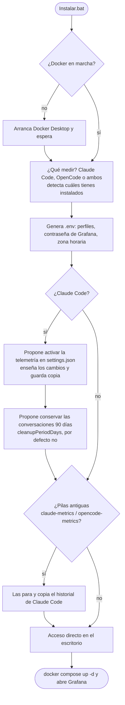
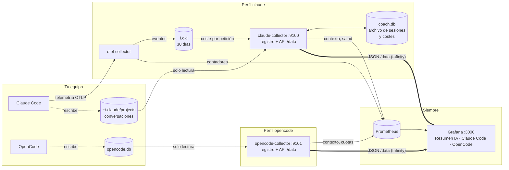
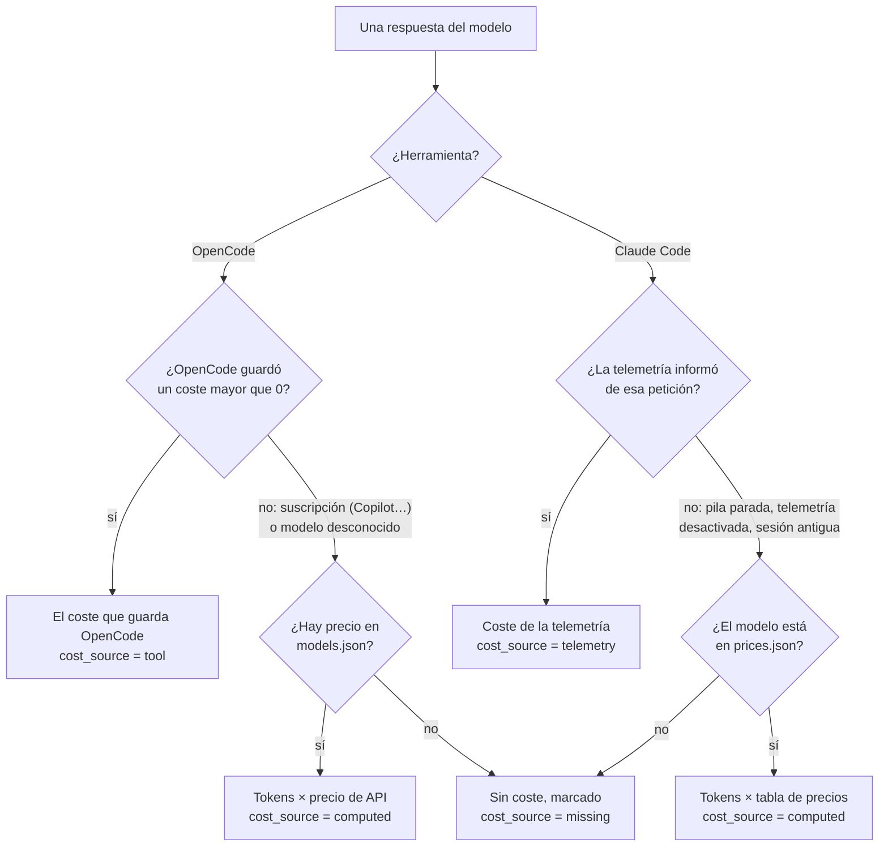
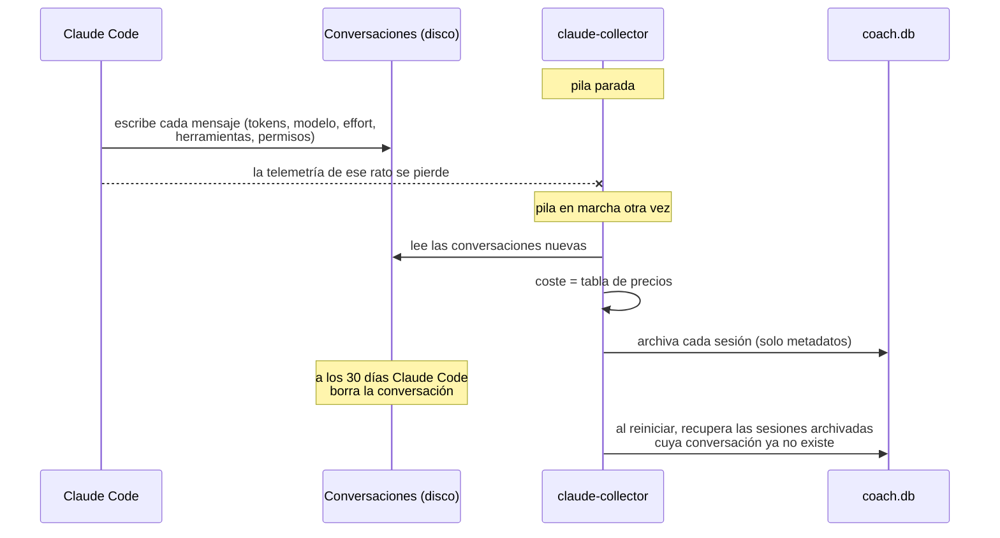

# IA-metrics

**Español** · [English](README.en.md)

Pila local de observabilidad para asistentes de código: **cuánto se usa y cuánto cuesta** Claude Code,
OpenCode o ambos. Une los proyectos `claude-metrics` y `opencode-metrics` en un solo repositorio, con un
Prometheus y un Grafana compartidos y un dashboard que suma el gasto de las dos herramientas.

- **Coste, tokens, sesiones, modelos, agentes, effort, skills, comandos y herramientas**, por proyecto y
  con el selector de tiempo de Grafana, en tu hora local.
- **Todo el historial**, también lo que hiciste con la pila parada: los colectores leen las
  conversaciones de Claude Code y la base de datos de OpenCode, no solo la telemetría.
- **Informe de mejoras** con hallazgos y recomendaciones, descargable en Markdown para dárselo a una IA.
- **Local y privado**: todo en `127.0.0.1`, sin enviar nada fuera de tu equipo.

## Instalación

Requisitos: Windows con Docker Desktop (o Rancher Desktop / Podman con `docker compose`). El primer
arranque necesita internet para descargar las imágenes y el plugin Infinity de Grafana.

Ejecuta **`Instalar.bat`**. Para cambiar de herramientas más adelante, vuelve a ejecutarlo.



Sin preguntas: `powershell -File installer\install.ps1 -Tools claude,opencode`
(otras opciones: `-NoStart`, `-SkipClaudeSettings`, `-SkipMigration`, `-NoShortcut`).

A mano: copia `.env.example` a `.env`, define `GRAFANA_ADMIN_PASSWORD` y `COMPOSE_PROFILES`
(`claude`, `opencode` o `claude,opencode`) y ejecuta `docker compose up -d`.

## Qué se abre

| Dirección | Qué es |
| --- | --- |
| http://localhost:3000 | Grafana (usuario `admin`). Inicio: **Resumen IA**, el gasto de las dos herramientas |
| http://localhost:3000/d/claude-code | Dashboard de Claude Code — [guía](docs/claude-code.md) |
| http://localhost:3000/d/opencode-usage | Dashboard de OpenCode — [guía](docs/opencode.md) |
| http://localhost:9100/sessions · `/report` · `/prices` | Sesiones, informe de mejoras y precios de los modelos de Claude Code |
| http://localhost:9101/sessions · `/report` · `/prices` | Sesiones, informe de mejoras y precios de los modelos de OpenCode |

Qué muestra cada gráfica y cómo leerla: [guía de las gráficas](docs/dashboards.md).

Prometheus, Loki y el OTel Collector no se publican en tu equipo (no tienen autenticación): Grafana y los
colectores los usan por la red interna de Docker. Solo queda abierto el 4317, por donde Claude Code envía la
telemetría. Para depurar: `docker compose -f docker-compose.yml -f docker-compose.debug.yml up -d` abre
9090, 3100, 4318 y 8889 (siempre en `127.0.0.1`); `docker compose up -d` los vuelve a cerrar.

## Arquitectura



- **Perfiles de Docker Compose.** Prometheus y Grafana arrancan siempre; el resto según
  `COMPOSE_PROFILES` en `.env` ([ADR 0001](docs/adr/0001-pila-unica-docker-compose-con-perfiles.md)).
- **Registro por petición y API de datos.** Cada colector guarda una fila por respuesta del modelo, con las
  mismas columnas en las dos herramientas, y la sirve en JSON (`/data`). Grafana la lee con el datasource
  Infinity y el selector de tiempo; Prometheus queda para lo que es estado actual (contexto de las sesiones,
  cuotas, salud) ([ADR 0002](docs/adr/0002-registro-por-peticion-y-api-de-datos.md)).
- **Un código, dos colectores.** Python de la librería estándar en `python:3.13-alpine`, con `collectors/`
  montado en `/srv` y lo común en `collectors/common/` (API de datos, cabecera Host, página del informe).

### De dónde sale el coste



La tabla de precios (`collectors/claude/prices.json`) tiene fecha de inicio para cada precio, tramos por
tamaño de prompt, escrituras de caché de 5 min y 1 h, modo rápido, inferencia en EE. UU. y búsquedas web.
Frente a la telemetría da **0,0 % de desviación** en los modelos probados. Para ver de dónde sale cada coste:
`http://localhost:9100/data/usage?group=cost_source`.

En OpenCode el precio sale de su caché de models.dev (`models.json`): el del propio proveedor o, si no lo da
(como GitHub Copilot), el del fabricante del modelo, buscado por nombre (`github-copilot/claude-opus-4.6` →
`anthropic/claude-opus-4-6`). Los modelos locales (LM Studio, Ollama…) cuestan 0. El informe de mejoras de
OpenCode sigue usando el coste que guarda OpenCode.

**Modelos sin precio.** Cada colector comprueba solo, cada vez que lee datos nuevos, que todos tus modelos
tienen precio. El panel «Modelos sin precio» de cada dashboard se pone en rojo si falta alguno,
`Iniciar-metricas.bat` lo avisa al arrancar y el enlace «Precios de los modelos» (o pulsar el panel) abre
`/prices` en una pestaña nueva: cada modelo con su precio, de dónde sale, uso y coste. `/prices/missing` da
la lista en texto. En Claude Code se arregla añadiendo el modelo a `prices.json` (precios de la
[página oficial](https://platform.claude.com/docs/en/about-claude/pricing)) y reiniciando `claude-collector`;
en OpenCode, dando su `cost` en la configuración de OpenCode.

### Qué pasa si la pila está parada



Con la pila parada solo se pierde lo que Claude Code **no** escribe en la conversación: el coste de las
llamadas que hace por su cuenta (títulos, resúmenes al compactar…). Todo lo demás, incluido el effort y las
decisiones de permisos, se recupera al volver a arrancar. OpenCode no tiene este problema: su base de datos
lo guarda todo.

### API de datos

```
GET http://localhost:9100/data                        # conjuntos de datos de Claude Code y sus columnas
GET http://localhost:9101/data/usage?group=day,model&from=<ms>&to=<ms>&project=demo
```

| Conjunto | Qué es | Herramientas |
| --- | --- | --- |
| `usage` | una fila por respuesta del modelo: coste, tokens, modelo, agente, effort, proyecto… | ambas |
| `sessions` | sesiones principales, por fecha de creación | ambas |
| `prompts` | una fila por turno (un prompt y todo lo que costó responderlo), con su texto | ambas |
| `tools` | llamadas a herramientas: errores, bytes devueltos, duración | ambas |
| `skills` | usos de skills y comandos, y el coste de sus turnos | ambas |
| `compactions` | compactaciones de contexto | ambas |
| `interrupts`, `commands` | respuestas interrumpidas; coste de los turnos de cada comando | Claude Code |

Parámetros: `from`/`to` (ms), `project`, `group` (columnas y `hour`/`day`/`week`/`month`), `measures`,
`f.<campo>`/`nf.<campo>` (filtros), `calc` (p. ej. `share:cost/total_cost`), `top=model:10&other=otros`,
`distinct=session`, `mask=prompt`, `sort`, `limit`. Detalle en `collectors/common/ledger.py`.

## Estructura

```
docker-compose.yml          servicios y perfiles
.env.example                variables (las escribe el instalador)
Instalar.bat                instalador (installer/install.ps1)
Iniciar-metricas.bat        arranca la pila, abre Grafana y avisa si algún modelo no tiene precio
docker-compose.debug.yml    publica Prometheus, Loki y el collector en 127.0.0.1 mientras depuras
collectors/common/          API de datos, cabecera Host y página del informe, compartidos
collectors/claude/          colector de Claude Code: índice, registro, tabla de precios, informe
collectors/opencode/        colector de OpenCode: lectura de opencode.db, precio de API (api_prices.py), registro, informe
config/                     OTel Collector, Loki, Prometheus y provisioning de Grafana
grafana/dashboards/         global/, claude/, opencode/ (una carpeta de Grafana por subcarpeta)
docs/                       guías de cada dashboard, decisiones (adr/) y documentos de los proyectos originales (legacy/)
tests/                      tests (python tests/run.py) y datos de ejemplo
tools/                      generador del Resumen IA y comprobador de precios
```

## Comandos útiles

```bash
docker compose up -d --wait                            # arrancar con los perfiles de .env y esperar a que estén sanos
docker compose ps                                      # estado y salud (healthy) de cada servicio
docker compose restart grafana                         # aplicar cambios en grafana/dashboards
docker compose restart claude-collector opencode-collector   # aplicar cambios en collectors/
python tests/run.py                                    # tests (PyYAML para los de configuración)
python tools/check_claude_prices.py                    # ¿tienen precio todos tus modelos de Claude Code? (= /prices)
curl -s http://localhost:9100/prices/missing           # modelos sin precio (9101: OpenCode); PENDIENTE mientras lee
docker compose -f docker-compose.yml -f docker-compose.debug.yml up -d   # abrir los puertos de depuración
python tools/check_claude_prices.py --fields           # qué campos tienen tus conversaciones (sin valores)
python tools/check_claude_prices.py --values           # valores de los campos de categoría (effort, permisos…)
python tools/dashboards/global_overview.py             # regenerar el Resumen IA
docker compose exec claude-collector python /srv/claude/coach/cli.py report --window 30 > informe.md
docker compose exec opencode-collector python /srv/opencode/coach/cli.py report --window 30 > informe.md
```

## Privacidad

- **Solo lectura y solo metadatos.** De Claude Code se montan `projects`, `commands` y `skills`, nunca
  `~/.claude` entero ni `settings.json`. De OpenCode, `opencode.db`, `models.json` y la carpeta de comandos.
  Nada se guarda en disco con texto de conversaciones, prompts o errores: los errores se clasifican en
  memoria y de cada resultado de herramienta solo se guardan su tamaño y su duración.
- **Archivo de sesiones** (`coach.db`): tokens, modelos, herramientas, skills e identificadores de cada
  sesión, para que el historial sobreviva a que Claude Code borre conversaciones. Nunca texto, títulos ni rutas.
- **Texto de los prompts.** «Prompts más caros» puede enseñar los primeros 300 caracteres de cada prompt.
  El texto vive solo en la memoria del colector. El selector **«Texto de los prompts»** de cada dashboard lo
  muestra u oculta (por defecto, oculto); oculto, el colector envía asteriscos, así que el texto ni llega al
  navegador. `CLAUDE_PROMPT_TEXT=0` en `.env` hace que el colector de Claude Code ni lo lea.
- **Telemetría de Claude Code.** Solo se usan los eventos de coste, resultados de herramientas y decisiones
  de permisos. Si en `settings.json` tienes `OTEL_LOG_USER_PROMPTS=1`, el texto de tus prompts se guarda en
  Loki 30 días sin que nada lo use: puedes quitarla.
- **Red.** Solo se publican Grafana, los dos colectores y el 4317 de la telemetría, todos en `127.0.0.1`.
  Prometheus, Loki y el resto del collector no tienen autenticación ni comprueban la cabecera `Host`, así
  que no se publican (salvo con `docker-compose.debug.yml`). Los colectores rechazan peticiones con una
  cabecera `Host` desconocida (protección frente a DNS rebinding; nombres extra en `ALLOWED_HOSTS`).
- **settings.json.** El instalador es lo único que lo toca, con tu confirmación y copia previa en
  `installer/backups/`.

## Limitaciones

- El coste es una estimación a precio de API, no una factura. Con suscripción (Claude Pro/Max, GitHub
  Copilot…) no es lo que pagas, sino lo que costaría pagando por token. En OpenCode,
  `OPENCODE_SUBSCRIPTION_PROVIDERS` marca esos proveedores como «suscripción» en `/prices`.
- El coste calculado de Claude Code depende de que `prices.json` esté al día, y el de OpenCode de que
  models.dev conozca el modelo. Si falta un precio, el panel «Modelos sin precio» se pone en rojo (ver arriba).
- Con la pila parada se pierde el coste de las llamadas que Claude Code no escribe en la conversación.
- Si Claude Code borra una conversación mientras la pila está parada más tiempo que `cleanupPeriodDays`
  (30 días por defecto), esa sesión no llega a contarse.
- En «Herramientas», la duración va de la llamada a su resultado e incluye la espera a que apruebes un permiso.
- Si eliges una sola herramienta, su dashboard queda vacío y los paneles del Resumen IA muestran un aviso de
  conexión para la otra.
- Sin copias de seguridad de los volúmenes ni alta disponibilidad: es una herramienta local de un usuario.

## Próximos pasos

- Unificar el motor de reglas del informe (D1–D10) en `collectors/common/` (las páginas HTML y el formato
  del informe ya están ahí).
- Alertas (presupuesto, contexto casi lleno).

Arquitectura (arc42): [docs/architecture](docs/architecture/README.md). Decisiones: [docs/adr](docs/adr/README.md).

Comparativa con los proyectos originales: [docs/comparativa-ia-metrics.md](docs/comparativa-ia-metrics.md).

