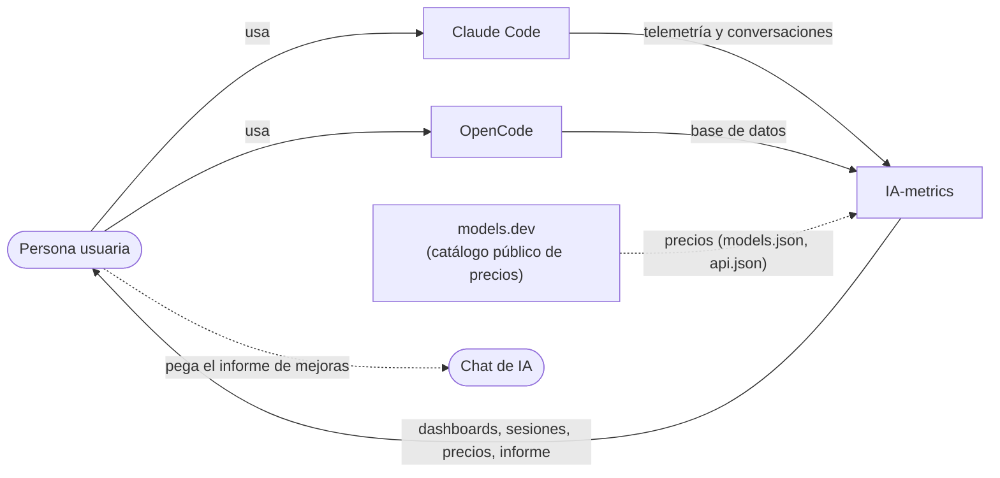

# Contexto y alcance

## Contexto de negocio

IA-metrics observa las dos herramientas y presenta uso, coste y recomendaciones. No cambia su
comportamiento: la única escritura fuera de su carpeta es la que hace el instalador en
`~/.claude/settings.json`, con confirmación y copia previa. El informe de mejoras sale del sistema solo si
la persona lo copia a un chat de IA.

## Contexto técnico

| Vecino | Canal | Dirección | Contenido |
| --- | --- | --- | --- |
| Claude Code | OTLP gRPC a `127.0.0.1:4317` | entrada | Métricas y eventos (`api_request`, `tool_result`, `tool_decision`) |
| Claude Code | Ficheros `~/.claude/projects/**/*.jsonl` (solo lectura) | entrada | Conversaciones: se leen tokens, modelos, herramientas, títulos |
| Claude Code | `~/.claude/commands`, `~/.claude/skills` (solo lectura) | entrada | Inventario para el informe |
| Claude Code | `~/.claude/settings.json` (instalador) | salida | Variables de telemetría y `cleanupPeriodDays` |
| OpenCode | `~/.local/share/opencode/opencode.db` (solo lectura) | entrada | Mensajes, sesiones, partes, coste y tokens |
| OpenCode | `~/.cache/opencode/models.json` y estado de cuotas (solo lectura) | entrada | Límites de contexto y precios de models.dev; cuotas del plugin `opencode-quota` |
| Navegador | HTTP a `127.0.0.1:3000`, `:9100`, `:9101` | salida | Grafana y páginas de los colectores |
| grafana.com | HTTPS en el primer arranque | entrada | Plugin Infinity |
| models.dev | HTTPS una vez al día (`MODELS_DEV_URL`, se puede desactivar) | entrada | Catálogo de precios de respaldo para Claude Code ([ADR 0006](../adr/0006-precios-de-claude-code-desde-models-dev.md)) |

## Correspondencia de canales

| Canal | Bloque que lo atiende ([05](05-building-block-view.md)) |
| --- | --- |
| OTLP 4317 | `otel-collector` → Prometheus (métricas) y Loki (eventos) |
| Conversaciones y comandos de Claude Code | `claude-collector` |
| `opencode.db`, `models.json`, cuotas | `opencode-collector` |
| Puerto 3000 | Grafana |
| Puertos 9100 y 9101 | Páginas, `/data`, `/prices`, `/report`, `/health` de cada colector |
