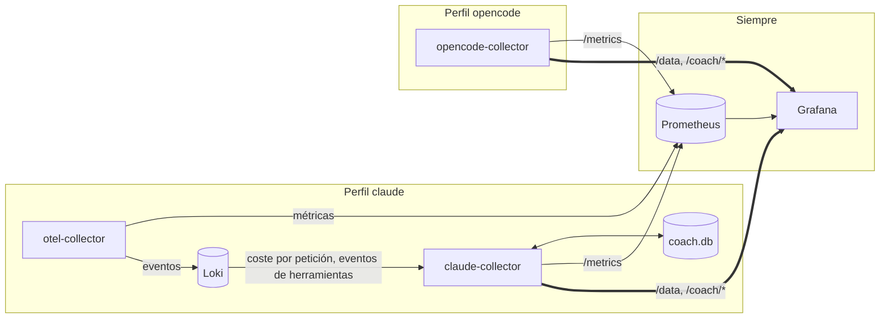

# Vista de bloques

## Caja blanca del sistema

### Visión general

### Motivo de la descomposición

Los servicios de terceros (OTel Collector, Loki, Prometheus, Grafana) se usan tal cual, configurados desde
`config/`. Todo el código propio está en dos colectores, uno por herramienta, porque sus fuentes no se
parecen (telemetría más ficheros JSONL frente a una base SQLite), pero comparten imagen, árbol de código y
contrato de datos ([ADR 0001](../adr/0001-pila-unica-docker-compose-con-perfiles.md),
[ADR 0002](../adr/0002-registro-por-peticion-y-api-de-datos.md)).

### Bloques

| Bloque | Responsabilidad | Interfaces | Código o configuración |
| --- | --- | --- | --- |
| otel-collector | Recibir la telemetría de Claude Code y repartirla | OTLP 4317/4318; `:8889/metrics`; métricas internas en `:8888`; OTLP HTTP a Loki | `config/otel-collector.yaml` |
| Loki | Guardar los eventos de Claude Code 30 días | API de consulta en `loki:3100` | `config/loki.yaml` |
| Prometheus | Estado actual: contexto de sesiones, cuotas, salud, contadores OTel, frescura de las fuentes y salud del canal de telemetría | Scrape de `otel-collector` (8889 y 8888), `loki`, `claude-collector`, `opencode-collector` | `config/prometheus/prometheus.yml` |
| Grafana | Dashboards Resumen IA, Claude Code y OpenCode | Datasources Prometheus, Loki, Infinity (`coach-claude`, `coach-opencode`) | `config/grafana/`, `grafana/dashboards/` |
| claude-collector | Índice de conversaciones, coste híbrido, registro `/data`, páginas, informe | HTTP 9100 | `collectors/claude/` |
| opencode-collector | Lectura de `opencode.db`, precio de API, registro `/data`, páginas, informe | HTTP 9101 | `collectors/opencode/` |
| Instalador | Elegir perfiles, generar `.env`, configurar telemetría, migrar volúmenes, arrancar; `--update` y `--uninstall` | `.bat` (Windows) y `.sh` (Unix) que lanzan el instalador por `installer/run.bat` / `run.sh` | `installer/install.py` (multiplataforma, ADR 0008), en el equipo o, sin Python, en un contenedor en modo delegado (ADR 0009) |

### Interfaces importantes

- **`/data/<conjunto>`** (ambos colectores): filas por petición con las mismas columnas en las dos
  herramientas, agrupables, filtrables y con zona horaria local. Conjuntos: `usage`, `sessions`, `tools`,
  `prompts`, `compactions`, `skills`, y en Claude Code además `interrupts`, `commands` y `background` (coste
  de las llamadas que no se escriben en la conversación: solo telemetría). Motor en
  `collectors/common/ledger.py`; contrato en el docstring de cada `ledger_source.py`.
- **`/metrics`**: texto Prometheus con lo que es estado actual; nunca series por día.
- **`/coach/*`, `/report`, `/report.md`, `/report.json`**: informe de mejoras (reglas D1–D10 comunes, C1–C6
  de Claude Code, D11 de OpenCode).
- **`/prices`, `/prices/missing`**: precio de cada modelo y modelos sin precio.
- **`/sessions`, `/session/<id>`, `/health`**: páginas de sesión y salud.

Toda ruta pasa primero por `common/security.py` ([08](08-crosscutting-concepts.md#seguridad-de-red-local)).

## Nivel 2

### Caja blanca: claude-collector

| Módulo | Responsabilidad |
| --- | --- |
| `map.py` | Servidor HTTP y rutas; `/metrics`; páginas de precios |
| `index.py` | Lectura incremental de `~/.claude/projects` en un hilo; coste por petición desde Loki; `hybrid_cost` |
| `pricing.py`, `prices.json` | Tabla de precios con periodos, tramos, modo rápido e inferencia en EE. UU.; respaldo con la copia de models.dev ([ADR 0006](../adr/0006-precios-de-claude-code-desde-models-dev.md)) |
| `ledger_source.py` | Conjuntos de `/data` |
| `pages.py`, `report_page.py` | Páginas HTML |
| `coach/` | Informe: `inventory` (comandos y skills), `report` (reglas), `render` (Markdown), `store` (`coach.db`), `metrics` (hilo de fondo y hallazgos), `errors` (clasificación en memoria), `cli` |

### Caja blanca: opencode-collector

| Módulo | Responsabilidad |
| --- | --- |
| `exporter.py` | Servidor HTTP y rutas; hilo de fondo que lee `opencode.db` (series, skills, comandos, prompts); cuotas |
| `oc_schema.py` | Vistas temporales `session`/`message`/`part` con la forma de 1.x sobre una base de datos de OpenCode 2.x ([ADR 0010](../adr/0010-compatibilidad-con-opencode-2.md)) |
| `catalog.py` | Catálogo de models.dev: `models.json` (1.x) o tabla `kv` de `opencode.db` (2.x), normalizado a la forma de 1.x |
| `api_prices.py` | Precio de API desde el catálogo de models.dev y coste híbrido ([ADR 0005](../adr/0005-coste-de-opencode-a-precio-de-api.md)) |
| `ledger_source.py` | Conjuntos de `/data` |
| `session_page.py`, `report_page.py` | Páginas HTML |
| `coach/` | Informe: `index` (llamadas a herramientas), `report`, `render`, `metrics` (instantánea compartida), `errors`, `cli` |

### Caja blanca: collectors/common

| Módulo | Responsabilidad |
| --- | --- |
| `ledger.py` | Motor de consultas de `/data` (agrupar, filtrar, `top`, `calc`, `mask`) |
| `security.py` | Comprobación de la cabecera `Host` |
| `report_page.py`, `html_page.py` | Página del informe; CSS y funciones de las páginas |
| `markdown.py` | Formato del informe (celdas en una línea) |
| `coach_rules.py` | Catálogo de reglas, umbrales de D1–D10, severidad y forma de un hallazgo, comunes a los dos informes |
