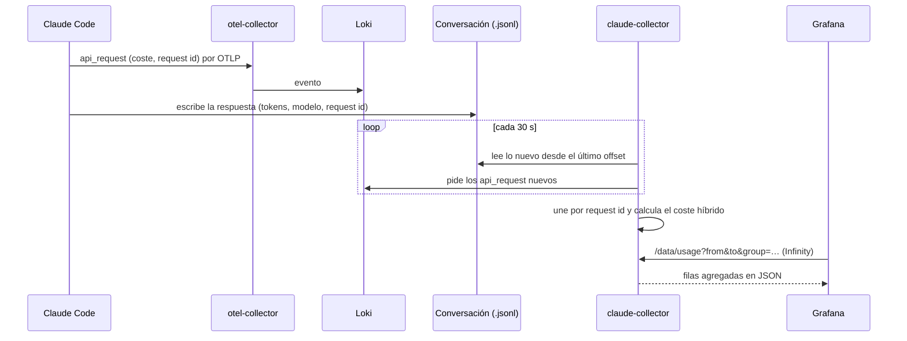

# Vista de ejecución

## Una petición de Claude Code llega al dashboard

### Interacciones destacables

- El coste se une a la conversación por `requestId`; sin evento de telemetría, se calcula con `prices.json`
  ([08](08-crosscutting-concepts.md#coste-híbrido)).
- Cada ronda guarda en `coach.db` los costes nuevos y archiva las sesiones cambiadas.

### Comportamiento ante fallos

- **Pila parada:** las conversaciones siguen en disco y se leen al arrancar; se pierde el coste de las
  llamadas que Claude Code no escribe en la conversación (README, «Limitaciones»).
- **Loki caído:** el índice sigue con la tabla de precios; los costes de telemetría llegan cuando Loki vuelve.
- **Un fichero que no se puede leer:** se avisa en el log y se salta hasta que cambie; la lectura inicial
  termina igualmente.

## OpenCode: de opencode.db a /metrics y /data

Un hilo de fondo del colector, cada 30 s, lee skills, comandos y prompts nuevos, refresca el índice de
herramientas y la instantánea que usan `/data` y el informe, y cada `SERIES_SECONDS` (60 s) recalcula las
series de `/metrics`. Las peticiones HTTP solo copian lo calculado; `/data` aplica a cada mensaje
`api_prices.hybrid` ([ADR 0005](../adr/0005-coste-de-opencode-a-precio-de-api.md)).

### Comportamiento ante fallos

- `opencode.db` bloqueada o sin ficheros WAL: se abre con `immutable=1`.
- Error en una ronda: aviso en el log; se sigue sirviendo la última caché.

## Arranque

1. El lanzador (`Iniciar-metricas.bat` en Windows, `iniciar-metricas.sh` en Unix, o `install.py --start`) arranca Docker si hace falta y ejecuta `docker compose up -d`.
2. Grafana espera a que Prometheus esté sano; `up -d --wait` espera a que todo lo esté (hasta 3 min).
3. `claude-collector` restaura costes y sesiones archivadas de `coach.db` y relee todas las conversaciones;
   mientras tanto `/health` y `/prices/missing` informan del progreso.
4. El script consulta `/prices/missing` de cada colector y avisa de modelos sin precio.
