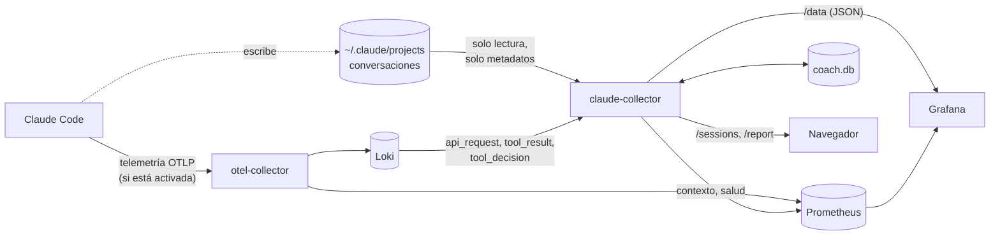

# Claude Code en IA-metrics

Guía del dashboard **Claude Code** (http://localhost:3000/d/claude-code), de su colector y de su informe
de mejoras. La instalación y la arquitectura general están en el [README](../README.md).

## De dónde salen los datos



| Fuente | Qué aporta |
| --- | --- |
| **Conversaciones** (`~/.claude/projects`) | Cada respuesta del modelo con sus tokens (incluido el desglose de caché de 5 min / 1 h), modelo, effort, proyecto, subagente y skill; cada llamada a herramienta con su resultado (tamaño, duración, error clasificado) y la decisión de permisos; comandos, compactaciones, interrupciones y el texto de los prompts (solo en memoria). Están aunque la pila estuviera parada. |
| **Telemetría** (OTel → Loki) | El coste de cada petición según Claude Code y las llamadas que no se escriben en la conversación (títulos, resúmenes al compactar…). |
| **coach.db** | Archivo de cada sesión (solo metadatos) y de los costes de la telemetría, para que el historial no dependa de los 30 días de Loki ni de que Claude Code conserve las conversaciones. |

El **proyecto** de una sesión es la carpeta de trabajo (`cwd`) donde se abrió. Con `PROJECT_ROOTS` en
`.env` (por ejemplo `C:\Workspace`), una sesión abierta en `C:\Workspace\miapp\src` cuenta para `miapp`.

### Coste híbrido

Para cada respuesta: el coste de la telemetría si Claude Code lo informó; si no, tokens × tabla de precios
(`collectors/claude/prices.json`) o, si el modelo no está, con el precio de models.dev (copia diaria; ADR 0006);
si no lo tiene ninguna, queda marcado como `missing` y no suma.
La tabla reproduce el coste de la telemetría con un 0,0 % de desviación. La comprobación de que todos
tus modelos tienen precio es automática: el colector la repite cada vez que lee conversaciones nuevas, el
panel «Modelos sin precio» del Resumen se pone en rojo si falta alguno (lista en
`http://localhost:9100/prices/missing`, y aviso en `docker compose logs claude-collector`) e
`Iniciar-metricas.bat` lo avisa al arrancar. El enlace «Precios de los modelos» del dashboard (o pulsar ese panel) abre
en una pestaña nueva `http://localhost:9100/prices`: tus modelos con su precio, uso y coste estimado, y la tabla de
precios completa. Es lo mismo que `python tools/check_claude_prices.py`, sin tener que ejecutarlo.

## Configurar la telemetría

El instalador lo hace por ti. A mano, añade al bloque `env` de `~/.claude/settings.json`:

```json
{
  "env": {
    "CLAUDE_CODE_ENABLE_TELEMETRY": "1",
    "OTEL_METRICS_EXPORTER": "otlp",
    "OTEL_LOGS_EXPORTER": "otlp",
    "OTEL_EXPORTER_OTLP_PROTOCOL": "grpc",
    "OTEL_EXPORTER_OTLP_ENDPOINT": "http://localhost:4317",
    "OTEL_EXPORTER_OTLP_METRICS_TEMPORALITY_PREFERENCE": "cumulative"
  }
}
```

Se lee al empezar una sesión. `OTEL_LOG_USER_PROMPTS` y `OTEL_LOG_TOOL_DETAILS` ya no hacen falta: los
prompts y las skills salen de las conversaciones.

## El dashboard

Filtros de arriba: el **selector de tiempo** de Grafana, **Proyecto**, **Sesiones** y **Texto de los
prompts** (Oculto / Visible). Los días y las horas se cuentan en la zona `TZ` del colector (Europe/Madrid
por defecto).

### Resumen

| Panel | Qué muestra |
| --- | --- |
| Coste estimado · Tokens · USD por millón de tokens · Acierto de caché | Totales del periodo. El acierto de caché es la parte del input leída de caché. |
| Modelos sin precio | Modelos de tus conversaciones que no están en `prices.json` (en rojo si hay alguno): su coste sin telemetría queda como `missing`. Al pulsarlo, o con el enlace «Precios de los modelos», se abre `http://localhost:9100/prices` con tus modelos (precio, uso, coste estimado) y la tabla de precios completa. |
| Sesiones con actividad | Sesiones distintas con alguna respuesta en el periodo; enlace a la lista de sesiones. |
| Llamadas de fondo | Coste de las llamadas que Claude Code hace a la API pero no escribe en la conversación (títulos, resúmenes al compactar, clasificaciones). **No está incluido en «Coste estimado»**, que se calcula desde las conversaciones. Solo con telemetría; el detalle por origen, en la fila plegable del mismo nombre. |
| Evolución | Coste y tokens a lo largo del periodo; el tamaño de cada barra se adapta al rango (1 minuto con «últimos 15 minutos», días con un mes). |
| Coste por effort · Coste por proyecto | Reparto del coste. El effort sale de la telemetría o de la conversación; «desconocido» si ninguna lo tiene. |

### Reparto del gasto

| Panel | Qué muestra |
| --- | --- |
| Cuota de coste y de tokens por modelo | Los 10 modelos que más cuestan y el resto como «otros». |
| Detalle por modelo y effort | Coste de cada combinación. |

### Sesiones, skills y prompts

| Panel | Qué muestra |
| --- | --- |
| Contexto de las sesiones | Lo lleno que está el contexto de las sesiones recientes (Prometheus). El límite se supone 200 k salvo `CLAUDE_CONTEXT_LIMITS`, o 1 M si la sesión ya lo superó. |
| Uso de skills y comandos (veces) | Cuántas veces se usó cada uno como comando y como skill. |
| Modelos y origen por comando | El coste de los turnos que lanzó cada comando, por modelo y origen (principal, subagente…). |
| Prompts más caros | Los 15 turnos más caros (un prompt y todo lo que costó responderlo): texto, proyecto, sesión, modelo y coste. |
| Herramientas | Llamadas, bytes devueltos al contexto, tokens aproximados (bytes / 4) y duración media. La duración incluye la espera a que apruebes un permiso. |

### Mejoras

| Panel | Qué muestra |
| --- | --- |
| Mejoras detectadas · Impacto estimado | Número de hallazgos del informe y su impacto en dólares. |
| Errores evitables de herramientas | Errores que no son culpa de un permiso, de un hook o de que dijeras que no, sobre el total de llamadas. |
| Compactaciones e interrupciones | Veces que se compactó el contexto y respuestas que paraste. |
| Hallazgos · Hallazgos por regla | Lo que encontró el informe, una fila por hallazgo; pulsa una celda para leerla entera o abre el informe. |
| Errores evitables por herramienta y modelo · por semana | Dónde fallan las herramientas y si mejora con el tiempo. |
| Coste por mensaje de cada modelo, por semana | Para ver si un cambio de modelo abarata. |
| Bytes devueltos al contexto por herramienta | Las herramientas que más llenan el contexto. |

### Evolución por modelo

Tokens por modelo y coste por modelo y effort a lo largo del periodo, con barras que se adaptan al rango como
«Evolución». Las tres gráficas piden a la API `group=auto`: la API elige el tamaño de grupo para unas 40 barras y
nunca devuelve un punto anterior al inicio del rango, así que un periodo corto no queda vacío.

¿Dashboard vacío con un periodo corto? Mira «Estado de las fuentes» en el Resumen IA: dice cuándo fue la última
respuesta que se ha leído y si los colectores están leyendo.

### Llamadas de fondo (solo telemetría)

Las llamadas que Claude Code hace a la API pero **no escribe en la conversación**: generar el título de una
sesión, el resumen al compactar, clasificaciones de tema o cuota. Como el coste del dashboard se calcula desde
las conversaciones, estas **no se suman en «Coste estimado»**; por eso tienen su propia cifra.

- **Coste de llamadas de fondo** (cifra en la fila «Resumen», junto a «Coste estimado»): el total del periodo.
  Solo aparece con la telemetría activada (sin ella, estas llamadas no quedan registradas en ningún sitio): es
  justo lo que se pierde con la pila parada. Para el gasto real: «Coste estimado» + «Llamadas de fondo».
- **Detalle por origen** (fila plegable «Llamadas de fondo (detalle por origen)»): el mismo coste repartido por
  `query_source` (title, compact, …) y modelo. Si «compact» pesa, es que compactas mucho; parte las tareas largas
  en sesiones distintas.

Salen de `/data/background`: las peticiones de la telemetría cuyo `request_id` no tiene mensaje en ninguna
conversación (ni viva ni archivada).

## Páginas de sesión e informe de mejoras

- http://localhost:9100/sessions: lista de sesiones con su coste; cada una abre su detalle (contexto,
  modelos, herramientas, skills). Las sesiones cuya conversación ya borró Claude Code salen sin título.
- http://localhost:9100/report: el informe de mejoras del periodo y proyectos elegidos, descargable en
  Markdown para pegarlo en un chat con una IA. No contiene texto de conversaciones.

Reglas del informe (D1–D10 son comunes con OpenCode):

| Regla | | Regla | |
| --- | --- | --- | --- |
| D1 | Errores de herramienta | D9 | Interrupciones |
| D2 | Coste por modelo u origen | D10 | Comandos sin uso |
| D3 | Bucles y exploración | C1 | Effort |
| D4 | Contexto | C2 | Consumo de fondo |
| D5 | Permisos | C3 | Resultados grandes |
| D6 | Caché | C4 | Planes rechazados |
| D7 | Skills | C5 | Peticiones de permiso |
| D8 | Modelo fijado en comandos | C6 | Contexto inicial |

## Si la pila estaba parada

Al volver a arrancar, el colector lee las conversaciones nuevas y todo el dashboard y el informe se
completan, con el coste calculado con la tabla de precios. Solo se pierde el coste de las llamadas que
Claude Code no escribe en la conversación. Si Claude Code borra una conversación (`cleanupPeriodDays`,
30 días por defecto) **después** de que el colector la haya leído, su sesión sigue contando: está
archivada en `coach.db`.

## Variables de `.env`

| Variable | Para qué |
| --- | --- |
| `PROJECT_ROOTS` | Carpetas que contienen un proyecto por subcarpeta. |
| `CLAUDE_CONTEXT_LIMIT_DEFAULT`, `CLAUDE_CONTEXT_LIMITS` | Límite de contexto supuesto y excepciones por modelo. |
| `CLAUDE_PROMPT_TEXT` | `0` para que el colector no lea el texto de los prompts. |
| `TZ` | Zona horaria de los días y las horas. |
| `MODELS_DEV_URL` | Catálogo de precios de respaldo; vacío desactiva la descarga diaria de models.dev. |
| `COACH_RETENTION_DAYS` | Días de historial que guarda `coach.db` (0, por defecto, lo guarda todo); se compacta una vez al día. |
| `ALLOWED_HOSTS` | Nombres extra con los que abrir las páginas del colector. |

## Comprobaciones

```bash
docker compose exec prometheus wget -qO- http://otel-collector:8889/metrics | grep claude_code   # ¿llega la telemetría?
curl -s "http://localhost:9100/data/usage?group=cost_source"   # de dónde sale el coste
python tools/check_claude_prices.py                            # ¿tienen precio todos los modelos?
docker compose logs --tail 50 claude-collector
```

Prometheus (9090), Loki (3100) y los puertos 4318 y 8889 del collector no se publican en el PC porque no tienen autenticación. Para abrirlos mientras depuras: `docker compose -f docker-compose.yml -f docker-compose.debug.yml up -d`; `docker compose up -d` los vuelve a cerrar.
