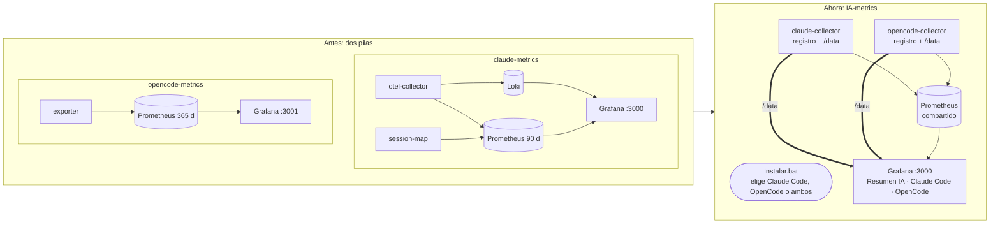
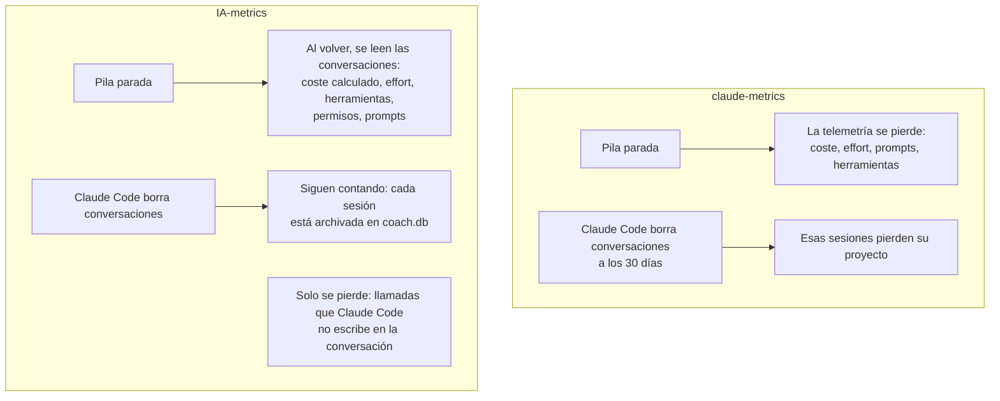

# IA-metrics frente a claude-metrics y opencode-metrics

Qué mejora IA-metrics respecto a los dos proyectos de los que nace, qué cuesta y qué queda pendiente.
Las cifras son de las comprobaciones hechas el 2026-11-20 con datos reales (una `opencode.db` de 1,15 GB y
las conversaciones y la telemetría de Claude Code del autor). Las decisiones están razonadas en
[docs/adr](adr/README.md).

## En una frase

`claude-metrics` y `opencode-metrics` eran dos pilas separadas que medían bien cada una su herramienta, pero
con datos que dependían de que la pila estuviera encendida (Claude Code) o guardados en Prometheus de una
forma que no escala (OpenCode). IA-metrics las une con un instalador, mide el gasto total en IA y saca casi
todo de los ficheros que las propias herramientas escriben en disco, así que el historial está completo
aunque la pila haya estado parada.

## De dos pilas a una

## Resumen por áreas

| Área | claude-metrics | opencode-metrics | IA-metrics |
| --- | --- | --- | --- |
| Instalación | Copiar `.env`, editar `settings.json` a mano, `.bat` de arranque | Copiar `.env`, `.bat` de arranque | `Instalar.bat`: elige herramientas, genera `.env` y contraseña, configura la telemetría con copia previa, detecta la zona horaria y migra las pilas antiguas |
| Herramientas | Solo Claude Code | Solo OpenCode | Una, otra o ambas (perfiles de Docker Compose) |
| Gasto total en IA | No | No | Dashboard «Resumen IA» con las dos herramientas sumadas |
| Grafana / Prometheus | Propios (:3000) | Propios (:3001) | Uno de cada, compartidos |
| Origen del coste | Contadores OTel por sesión | Lo que guarda OpenCode | Registro por petición: telemetría si existe; si no, tabla de precios; OpenCode, su coste |
| Historial | Desde que se activó la telemetría, y con huecos cuando la pila estaba parada | Completo | Completo en ambas, también con la pila parada |
| Selector de tiempo | El de Grafana | Propio (Periodo, Desde, Hasta) | El de Grafana en los tres dashboards |
| Días | UTC | UTC | Hora local (`TZ`, por defecto Europe/Madrid) |
| Datos por día | Series en Prometheus con el día como etiqueta | Igual | API JSON `/data` leída con Infinity |
| Pruebas | Ninguna | Ninguna | 6 suites (96 pruebas) y GitHub Actions |
| Código compartido | — | — | `collectors/common/`: API de datos, cabecera Host, página del informe |

## Exactitud del coste

| | Antes | Ahora |
| --- | --- | --- |
| Claude Code, mismas peticiones | Contadores OTel: **98,54 $** | Registro: **115,90 $** (los contadores perdían un 15 %) |
| Claude Code sin telemetría | Coste «—» | Tabla de precios con **0,0 %** de desviación frente a la telemetría en los cuatro modelos usados (~1.400 peticiones) |
| Fuentes de coste en Claude Code | Tres sin conciliar (OTel, Loki, conversaciones) | Una (`index.hybrid_cost`), usada por dashboards, páginas e informe |
| OpenCode | El de OpenCode | El mismo, comprobado al céntimo: las 17 series antiguas coinciden con la API (188,19 $) |

La tabla de precios (`collectors/claude/prices.json`) tiene fecha de inicio de cada precio, tramos por
tamaño de prompt, escrituras de caché de 5 min y 1 h, modo rápido, inferencia en EE. UU. y búsquedas web.

## Historial y pila parada

| Dato de Claude Code | claude-metrics | IA-metrics |
| --- | --- | --- |
| Coste | Solo con telemetría | Telemetría o tabla de precios |
| Effort | Solo con telemetría | También de la conversación (el 95 % de las respuestas lo traen) |
| Prompts más caros | Loki, 30 días, y solo con `OTEL_LOG_USER_PROMPTS=1` | Conversaciones, sin límite de días |
| Herramientas (bytes, duración) | Loki, 30 días | Conversaciones (`persistedOutputSize` y `durationMs` cuando existen) |
| Evolución en el tiempo (fila «Evolución por modelo») | Contadores OTel, por hora | Registro con grupo adaptable al periodo (`group=auto`) |
| Saber si los datos están al día | — | Fila «Estado de las fuentes» del Resumen IA |
| Decisiones de permisos del informe | Loki | Telemetría o conversación (mismos valores) |
| Sesiones con conversación borrada | Pierden su proyecto | Archivadas (solo metadatos) |

## Rendimiento y almacenamiento (OpenCode, datos reales)

| | opencode-metrics | IA-metrics |
| --- | --- | --- |
| Series en Prometheus | 6.640 en cada lectura, 5.776 de ellas por día o semana | Retiradas las 5.776 por día o semana (el 87 %); el scrape de OpenCode ya no lee la base de datos |
| Crecimiento | Lineal con el historial, reescrito cada 30 s durante 365 días | Prometheus solo guarda estado actual |
| Lectura de la base de datos | Todo el historial en cada lectura (unos 3 s, límite de 25 s) | Incremental: 0,6 s la primera vez, casi nada después |
| Consulta de un panel | PromQL con filtros de fecha encadenados | 116 ms (uso por día y modelo), 11 ms (prompts) |

## Dashboards

| | Antes | Ahora |
| --- | --- | --- |
| Gasto conjunto | — | Coste total, por herramienta, diario, por proyecto y eficiencia comparada |
| Prompts más caros | Solo Claude Code, con texto solo si se enviaba a Loki | Ambas herramientas, con selector «Texto de los prompts» (oculto por defecto; oculto, el texto no sale del colector) |
| Comandos | Comandos con el texto de su plantilla expandida | `/nombre` |
| Consultas | PromQL de varias líneas con `*_day_start_seconds` (102 usos solo en OpenCode) | Una URL de la API por panel, con proporciones, «N mayores + otros» y valores distintos calculados en el colector |
| Tablas | Filas altísimas cuando una celda estaba vacía | Una línea por fila; celdas vacías con «—» |

## Seguridad y privacidad

| | claude-metrics | opencode-metrics | IA-metrics |
| --- | --- | --- | --- |
| Puertos | `127.0.0.1`, salvo el 8889 abierto a la red | `127.0.0.1` | `127.0.0.1` en todos; Prometheus, Loki y el collector (salvo el 4317) ni se publican |
| Imágenes | `latest` en tres servicios | Versiones fijas | Versiones fijas (Grafana 13.2, rama con soporte); healthchecks en Prometheus, Grafana y los colectores |
| Protección frente a DNS rebinding | No | No | Los colectores validan la cabecera `Host` |
| Texto de prompts | En Loki 30 días si se activaba la opción | — | Solo en memoria del colector; el instalador ya no ofrece enviarlo a Loki |
| Logs de Docker | Sin límite, con el exportador `debug` activo | Sin límite | 10 MB × 3 por servicio, sin `debug` |
| `settings.json` | Se edita a mano | — | Solo el instalador, con confirmación y copia previa |

## Mantenimiento

| | Antes | Ahora |
| --- | --- | --- |
| Pruebas | Ninguna: un cambio de formato se veía mirando el dashboard | Datos de ejemplo de ambas herramientas, Loki falso, pruebas de equivalencia con las series antiguas, de cada URL de cada dashboard, de la tabla de precios, del contrato del informe y de la configuración |
| Comprobadores | — | `check_claude_prices.py` (precios, campos y valores de tus conversaciones, sin contenido); la equivalencia con las series antiguas queda en los tests (`tests/legacy_oracle.py`) |
| Dashboards | Editados a mano | JSON provisionado, comprobado por los tests; el Resumen IA se genera con un script |
| Decisiones | Sin ADR | ADR 0001 (pila única), 0002 (registro por petición y API), 0004 (pruebas) |
| Repositorio | Saltos de línea mezclados | `.gitattributes` (LF; CRLF en `.bat` y `.ps1`) |
| Documentación | Un README por proyecto | README en español e inglés con diagramas Mermaid, guía de cada dashboard |

## Lo que cuesta

- **Más código propio.** La API, el registro y la tabla de precios hay que mantenerlos; antes PromQL lo hacía
  «gratis».
- **La tabla de precios** hay que actualizarla con cada modelo nuevo (`tools/check_claude_prices.py` avisa).
- **Más dependencia del plugin Infinity**, que además necesita internet en el primer arranque.
- **Con una sola herramienta instalada**, los paneles del Resumen IA muestran un aviso de conexión para la otra
  (antes salía 0).
- **El instalador es solo para Windows**, aunque el compose también vale para macOS y Linux.

## Pendiente

- Medir cuánto suponen las llamadas que Claude Code no escribe en la conversación (lo único que aún se pierde
  con la pila parada).
- Alertas (presupuesto, contexto casi lleno).
