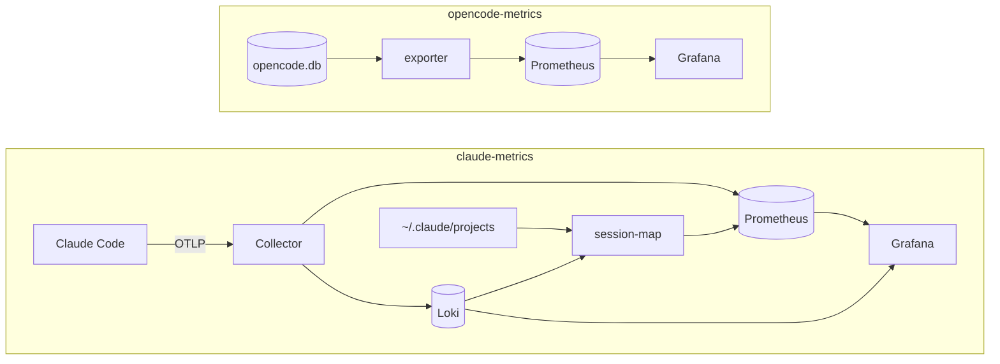

# Comparativa de claude-metrics y opencode-metrics

Documento para pedir feedback · 16/11/2026

## Para qué sirven

Son dos pilas locales de observabilidad con Docker Compose que responden a la misma pregunta: cuánto se usa y cuánto cuesta cada asistente de código. **claude-metrics** mide Claude Code; **opencode-metrics** mide OpenCode. Las dos acaban en un único dashboard de Grafana, con páginas propias de lista y detalle de sesión, y comparten estilo visual. Por eso es fácil compararlas, y por eso conviene decidir qué se unifica.

## Diferencia de fondo: de dónde salen los datos

- **claude-metrics** recibe telemetría que Claude Code envía por OpenTelemetry (métricas y eventos) y además lee los ficheros de conversación (`~/.claude/projects`) para el contexto, las sesiones y las skills. Hay que activar la telemetría en `settings.json`.
- **opencode-metrics** no necesita configurar nada en OpenCode: un exportador lee su base de datos SQLite en solo lectura y publica las métricas. Tiene historial desde la primera sesión que OpenCode guardó.

## Resumen comparativo

| Aspecto | claude-metrics | opencode-metrics |
| --- | --- | --- |
| Origen de los datos | Telemetría OpenTelemetry más ficheros de conversación | Base de datos SQLite de OpenCode, en solo lectura |
| Cambios en la herramienta medida | Sí: variables de telemetría en `settings.json` | Ninguno |
| Contenedores | 5 (collector, Loki, Prometheus, Session-map, Grafana) | 3 (exportador, Prometheus, Grafana) |
| Almacenes | Prometheus (90 días) y Loki (30 días) | Prometheus (365 días) |
| Historial disponible | Desde que se activó la telemetría; el coste de sesiones anteriores es «—» | Desde la primera sesión guardada, con su coste |
| Coste | Estimación del cliente por llamada; se casa con el fichero de conversación por identificador de petición | El coste que OpenCode guarda en cada mensaje |
| Dashboard | Uno, «Claude Code», 4 filas y 16 paneles, provisionado solo | Uno, «OpenCode - Uso y coste», 15 paneles, provisionado solo |
| Selector de periodo | El de tiempo de Grafana | Uno propio (Periodo, Desde, Hasta) |
| Selector de proyecto | Sí | Sí |
| Páginas de sesión | Lista y detalle en `127.0.0.1:9100` | Lista y detalle en `127.0.0.1:9101` |
| Skills y comandos | Sí, con el coste de los turnos que lanzó cada comando, por modelo y origen | Sí, con coste de los turnos en que se usaron |
| Contexto de las sesiones | Sí; el límite se supone (200k o 1M) salvo que se configure | Sí; el límite sale del catálogo de modelos de OpenCode |
| Imágenes de Docker | `latest` en tres de los cinco servicios | Versiones fijadas |
| Puertos | Publicados en todas las interfaces, salvo las páginas de sesión | Solo en `127.0.0.1` |
| Contraseña de Grafana | `admin` / `admin` en el compose | Se lee de `.env`, que git ignora |
| Documentación | README en inglés y español, guía de dashboards e infraestructura en `.md`, PDF y Word | Igual |
| Código propio | Unas 730 líneas de Python | Unas 960 líneas de Python |

## Qué mide cada una que la otra no

**Solo claude-metrics**
- **Texto y coste por prompt.** Los prompts más caros, con su texto, a partir de los eventos.
- **Herramientas.** Llamadas, bytes devueltos, tokens aproximados y duración media por herramienta.
- **Gasto por esfuerzo.** Reparto del coste por nivel de esfuerzo de razonamiento (`effort`).
- **Detalle por hora.** Tokens por modelo y coste por modelo y effort, hora a hora.
- **Dimensión de equipo.** La telemetría lleva usuario y equipo, útil si se centraliza.

**Solo opencode-metrics**
- **Cuota por proveedor.** Cuánto queda de cada cuota, si se instala el plugin `opencode-quota`.
- **Coste por agente.** Reparto por agente de OpenCode.
- **Evolución semanal.** 13 semanas, y actividad diaria por modelo en una fila plegable.
- **Historial completo.** Sin necesidad de haber activado nada antes.
- **Sin dependencia de telemetría.** Funciona con cualquier sesión ya guardada.

**En las dos:** coste estimado, tokens, USD por millón, acierto de caché, sesiones, coste y cuota por modelo y proyecto, contexto de las sesiones recientes, uso de skills y comandos, y páginas de lista y detalle de sesión.

## Puntos fuertes y débiles de cada enfoque

| | claude-metrics | opencode-metrics |
| --- | --- | --- |
| A favor | Datos ricos por llamada y por prompt; coste exacto de las llamadas registradas; soporte de equipo y de varias máquinas con telemetría | Sin configuración en la herramienta; historial completo; menos piezas; más seguro por defecto |
| En contra | Más piezas y más superficie; el historial de coste empieza al activar la telemetría; depende de nombres de métricas y eventos que Claude Code puede cambiar | Depende del esquema interno de la base de datos de OpenCode; recalcula todo en cada lectura (unos 3 s); sin detalle por llamada ni por herramienta |

## Puntos de mejora que veo

**En claude-metrics (copiando lo que ya hace bien OpenCode)**
- **Seguridad por defecto.** Publicar los puertos solo en `127.0.0.1`, leer la contraseña de Grafana de un `.env` y fijar las versiones de las imágenes.
- **Retención de métricas.** 90 días frente a los 365 de OpenCode. Loki, con 30, es el límite para los paneles de eventos.

**En opencode-metrics (copiando lo que ya hace bien Claude)**
- **Selector de periodo.** Usar el selector de tiempo de Grafana en lugar de Periodo, Desde y Hasta. En Claude se resolvió con `${__from:date:seconds}` y `${__to:date:seconds}` en las consultas, y elimina tres variables.
- **Lectura incremental.** Claude lee los ficheros de forma incremental; OpenCode recalcula todo en cada lectura. Funciona hoy, pero crecerá con el historial.

**En las dos**
- **Código duplicado.** Las páginas de sesión (`pages.py` y `session_page.py`), la página del informe (`report_page.py`, casi idéntica en las dos) y el estilo del dashboard se parecen mucho y se mantienen por separado. Una librería común, o un repositorio único con dos exportadores, evitaría que diverjan.
- **Sin pruebas automáticas.** Ni el exportador ni los generadores de dashboards tienen tests; un cambio de formato en la herramienta medida se detecta mirando el dashboard.
- **Sin alertas.** No hay aviso al pasar un presupuesto o al llegar una sesión al 85 % de contexto.
- **Sin copias de seguridad** de los volúmenes.
- **Una sola máquina.** Ninguna de las dos está pensada para varios usuarios; la de Claude podría, ya que la telemetría lleva usuario y equipo.
- **Comparación entre herramientas.** Cada pila tiene su Grafana y su Prometheus. Un dashboard que sume el gasto de las dos (o un Prometheus compartido) respondería a «cuánto gasto en total en IA de código».

## Preguntas para el feedback

- ¿Merece la pena unificar las dos pilas en un repositorio con código compartido, o mantenerlas separadas como están?
- ¿Es útil un dashboard conjunto del gasto de ambas herramientas, o solo complica?
- ¿Qué métricas echas de menos que ninguna de las dos tenga (por ejemplo, tiempo hasta el primer resultado, o errores de herramientas)?
- ¿Te parece bien que Claude dependa de telemetría y de ficheros, o preferirías el enfoque de solo lectura de OpenCode siempre que sea posible?
- ¿Qué aviso sería el primero que te gustaría tener: presupuesto, contexto casi lleno o herramientas lentas?
- ¿Algún panel que sobre, se entienda mal o se pueda explicar mejor?

## Limitaciones comunes

- El coste es una estimación, no una factura, y en proveedores por suscripción puede no reflejar lo que se paga.
- El coste de una skill o de un comando no se puede aislar: incluye todo lo que ocurre en su turno.
- Los títulos de las sesiones aparecen en las páginas de sesión, que se sirven sin autenticación en la máquina de la pila.
