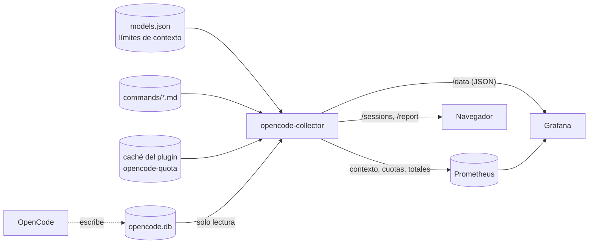

# OpenCode en IA-metrics

Guía del dashboard **OpenCode** (http://localhost:3000/d/opencode-usage), de su colector y de su informe
de mejoras. La instalación y la arquitectura general están en el [README](../README.md).

## De dónde salen los datos



No hay que configurar nada en OpenCode: el colector lee su base de datos en solo lectura y tiene el
historial desde la primera sesión guardada. El coste es el que OpenCode guarda en cada mensaje; cuando guarda 0
con tokens (suscripción como GitHub Copilot, o un modelo que no conoce), se calcula a precio de API con su caché de
models.dev (`models.json`): el precio del propio proveedor o, si no lo da, el del fabricante del modelo (Copilot →
Anthropic, OpenAI…). Es lo que costaría por API, no lo que pagas con la suscripción (`cost_source=computed` en `/data`).
El informe de mejoras sigue usando el coste que guarda OpenCode.

| Fuente | Qué aporta |
| --- | --- |
| `opencode.db` (tablas `session`, `message`, `part`, `project`) | Cada respuesta con su coste, tokens (input, output, razonamiento, caché), proveedor, modelo y agente; llamadas a herramientas y errores; skills, compactaciones, interrupciones y el texto de los prompts (solo en memoria). |
| `~/.cache/opencode/models.json` | El límite de contexto de cada modelo. Para modelos que no conoce: `OPENCODE_CONTEXT_LIMITS`. |
| `~/.config/opencode/commands` | Las plantillas de tus comandos: OpenCode guarda el comando ya expandido, y el colector lo reconoce por el principio de la plantilla. Los comandos definidos dentro de un proyecto no se ven. |
| Plugin `opencode-quota` (opcional) | Cuánto queda de la cuota de cada proveedor. |

El **proyecto** es la carpeta del `worktree` de OpenCode; las sesiones sin proyecto cuentan como `global`.

La lectura es incremental: la primera vez recorre toda la base de datos (con una de 1,15 GB, menos de un
segundo en el equipo) y después solo lo nuevo.

## El dashboard

Filtros de arriba: el **selector de tiempo** de Grafana, **Proyecto** y **Texto de los prompts**
(Oculto / Visible). Los días se cuentan en la zona `TZ` del colector (Europe/Madrid por defecto).

### Resumen y reparto

| Panel | Qué muestra |
| --- | --- |
| Coste estimado · Tokens · USD por millón de tokens · Acierto de caché · Sesiones | Totales del periodo; las sesiones son las principales, sin subagentes. |
| Modelos sin precio | Modelos con mensajes de coste 0 que no se pueden valorar porque no hay precio para ellos en models.json, ni de su proveedor ni de su fabricante (en rojo si hay alguno): su coste no cuenta. Al pulsarlo, o con el enlace «Precios de los modelos», se abre `http://localhost:9101/prices` con cada modelo, su precio de models.dev, uso y coste. `Iniciar-metricas.bat` también lo avisa al arrancar. |
| Contexto de las sesiones recientes | Lo lleno que está el contexto de las últimas sesiones. |
| Cuota y uso por proveedor | Coste, mensajes y tokens de cada proveedor, con su cuota si usas `opencode-quota`. |
| Evolución semanal | Coste y tokens por semana (últimas 14 semanas). |
| Coste por agente · Coste por proyecto | Reparto del coste. |
| Cuota de coste y de tokens por modelo | Los 10 modelos que más cuestan y el resto como «otros». |
| Comandos · Skills | Activaciones y coste de los turnos en que se usaron, desplegables por modelo y agente. |
| Prompts más caros | Los 15 turnos más caros: texto, proyecto, sesión, agente, modelo y coste. Un comando aparece como `/nombre`; los subagentes cuentan en su propia sesión. |
| Detalle por modelo | Mensajes, tokens, coste, porcentaje del coste y USD por millón de tokens. |

### Actividad diaria por modelo

Coste por día de los 8 modelos que más cuestan (el resto, «otros»), y una tabla con mensajes, tokens y coste
por día, proveedor y modelo.

### Mejoras

| Panel | Qué muestra |
| --- | --- |
| Mejoras detectadas · Impacto estimado | Hallazgos del informe y su impacto en dólares. |
| Errores evitables de herramientas | Errores que no son culpa de un permiso, de que dijeras que no o de una interrupción, sobre el total de llamadas. |
| Compactaciones e interrupciones (total y por semana) | Veces que se compactó el contexto y respuestas interrumpidas. |
| Hallazgos · Hallazgos por regla | Lo que encontró el informe; pulsa una celda para leerla entera o abre el informe. |
| Errores evitables por herramienta y modelo · por semana | Dónde fallan las herramientas y si mejora con el tiempo. |
| Coste por mensaje de cada agente, por semana | Para ver si cambiar el modelo de un agente abarata. |

## Páginas de sesión e informe de mejoras

- http://localhost:9101/sessions: lista de sesiones con su coste; cada una abre su detalle.
- http://localhost:9101/report: el informe de mejoras, descargable en Markdown. No contiene texto de
  conversaciones.

Reglas del informe (D1–D10 son comunes con Claude Code):

| Regla | | Regla | |
| --- | --- | --- | --- |
| D1 | Errores de herramienta | D7 | Skills |
| D2 | Coste por agente | D8 | Modelo fijado en comandos |
| D3 | Bucles y exploración | D9 | Interrupciones |
| D4 | Contexto | D10 | Comandos sin uso |
| D5 | Permisos | D11 | Variantes -fast |
| D6 | Caché | | |

## Variables de `.env`

| Variable | Para qué |
| --- | --- |
| `OPENCODE_DATA_DIR` | Dónde está `opencode.db` (por defecto `~/.local/share/opencode`). |
| `OPENCODE_CACHE_DIR` | Dónde está `models.json` (por defecto `~/.cache/opencode`). |
| `OPENCODE_COMMANDS_DIR` | Carpeta de comandos globales (por defecto `~/.config/opencode/commands`). |
| `OPENCODE_CONTEXT_LIMITS` | Límites de contexto de modelos que `models.json` no conoce (`proveedor/modelo=tokens`). |
| `OPENCODE_CONTEXT_SESSIONS` | Cuántas sesiones recientes muestra el panel de contexto. |
| `OPENCODE_SUBSCRIPTION_PROVIDERS` | Proveedores que pagas con suscripción (p. ej. `github-copilot`), separados por comas. Solo informativo: la página de precios los marca como «suscripción». |
| `TZ`, `LEGACY_DAY_METRICS`, `ALLOWED_HOSTS` | Como en Claude Code: zona horaria, series antiguas y nombres extra. |

## Comprobaciones

```bash
curl -s "http://localhost:9101/data/usage?group=model&sort=-cost&limit=5"   # coste por modelo
curl -s http://localhost:9101/prices/missing                               # ¿algún modelo sin precio?
python tools/check_opencode_equivalence.py <copia de opencode.db>          # API frente a las series antiguas
docker compose logs --tail 50 opencode-collector
```
